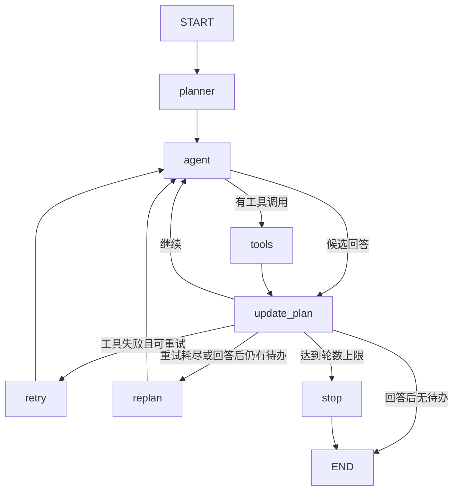

# Agent Project · Day 14

本次把 Day 13 手写的 `for + if` 调度换成真正的 LangGraph。
DeepSeek、工具函数、RAG、长期记忆和正式聊天历史的用途保持原有设计。

## 本地运行（PowerShell）

```powershell
cd C:\Users\Admin\Desktop\agent_project
git pull --ff-only origin main
.\.venv\Scripts\python.exe -m pip install -r requirements.txt
.\.venv\Scripts\python.exe main.py
```

如果 pull 提示本地改动冲突，先查看 `git status`，不要强制覆盖。
沿用本地 `.env` 中的 `DEEPSEEK_API_KEY`。RAG 初次运行需要下载原来的 embedding 模型。

## 建议阅读顺序

1. `workflow.py` 的 `build_graph()` **底部**：看 add_node/add_edge/add_conditional_edges。
2. `route_agent()`：模型请求工具时去 tools，否则去 update_plan。
3. `route_after_update()`：继续、重试、重规划、完成、超限停止。
4. `state.py`：messages/tool_history 用 operator.add 累积，其他字段覆盖。
5. `build_graph()` 中的各个节点：只返回本轮更新，不原地修改 State。
6. `agent.py`：call_agent 只请求模型；execute_tools 只执行工具并返回增量。
7. `run_workflow()`：创建初始状态，然后 app.invoke() 启动整张图。

## 真实执行图



条件文字对应 Router 的判断，不是额外的 Node。完成判断优先于轮数上限。

## 与 Day 13 的对应关系

| 文件 | Day 13 | Day 14 |
|---|---|---|
| workflow.py | for 循环 + if 调用节点 | StateGraph + Edge + 条件路由 + invoke |
| agent.py | run_agent_step 同时调用模型、执行工具、修改 State | call_agent 与 execute_tools 分离，由两个节点调用 |
| state.py | 所有字段靠业务代码更新 | messages/tool_history 声明追加 Reducer；增加 step_count |
| planner.py | update_plan_status 直接修改 state | 返回新计划，由节点返回、框架覆盖 |
| main.py | 调用 run_workflow，保存用户输入和最终回答 | 接口不变，因此无需修改 |
| requirements.txt | openai/python-dotenv | 增加 LangGraph，补齐已有 RAG 所用依赖 |

Day 13 对照版本：
https://github.com/LarsG33/agent_project/tree/b30e305cab5437b35a8d95b0697dbbb8ec5362d1

## Reducer：最值得对照的几行

```python
messages: Annotated[list[Any], operator.add]
tool_history: Annotated[list[ToolHistoryRecord], operator.add]
plan: list[PlanStep]
```

节点返回 `{"messages": [message]}`，框架将它追加到原来的 messages。
节点返回 `{"plan": new_plan}`，框架用它替换旧 plan。
**有追加 Reducer 的字段只能返回本轮增量，不能返回完整历史，否则会重复。**

这里继续使用 OpenAI 格式的普通消息字典，所以选用 operator.add。
前面讲的 add_messages 会把消息转换成 LangChain 消息对象，不能直接混用字典下标、
OpenAI SDK 消息和 `.tool_calls` 属性。本版本统一为字典，使用 `.get("tool_calls")`。
本次也保留手写工具节点，便于观察参数解析、执行和工具结果配对；尚未采用预制 ToolNode。

## 观察一次执行

输入：`请使用工具计算 (10 + 20) * 100`。

通常会看到以下节点顺序（模型选择可能不同）：

```text
[Node] planner
[Node] agent（第 1 轮）
[Node] tools
[Tool] calculator
[Result] 30
[Node] update_plan
[Node] agent（第 2 轮）
[Node] tools
[Tool] multiply
[Result] 3000
[Node] update_plan
[Node] agent（第 3 轮）
[Node] update_plan
AI：...3000...
```

模型产生的文本先作为候选回答；通过计划检查后才打印和保存为正式最终回答。
计划仍有 pending 时重新规划；达到 10 轮会停止，并清除未确认的候选回答。
failed 表示已确认失败的步骤，可以在最终回答里说明，不能等同于任务成功。
一次模型调用可能产生多个工具请求，tools 节点逐个执行并保留每个 tool_call_id。
工具失败先重试，最多连续重试 2 次，然后重新规划；仍受 10 轮总上限约束。
仓库当前没有 unstable_add，失败路径由离线测试模拟验证。

## 验证与范围

```powershell
.\.venv\Scripts\python.exe -m unittest discover -s tests -v
```

8 个离线测试覆盖实际 LangGraph 调度、消息累积、工具结果配对、失败重试、
重试耗尽后重新规划、候选回答未完成时重规划，以及最大轮数停止。
测试不调用 DeepSeek、不下载 RAG 模型、不修改个人记忆。实现使用 LangGraph 1.2.12 验证。
在线 DeepSeek/RAG 联调需要使用你本地环境进行；本次没有用你的 API Key 运行在线测试。

目前迁移的是执行调度和状态更新；尚未加入 checkpoint、断点恢复、人工审批或并行节点。
因此回答能力可能与 Day 13 很接近，最直观的区别在控制流、节点边界和 State 更新方式。

官方 Graph API 文档：https://docs.langchain.com/oss/python/langgraph/graph-api
