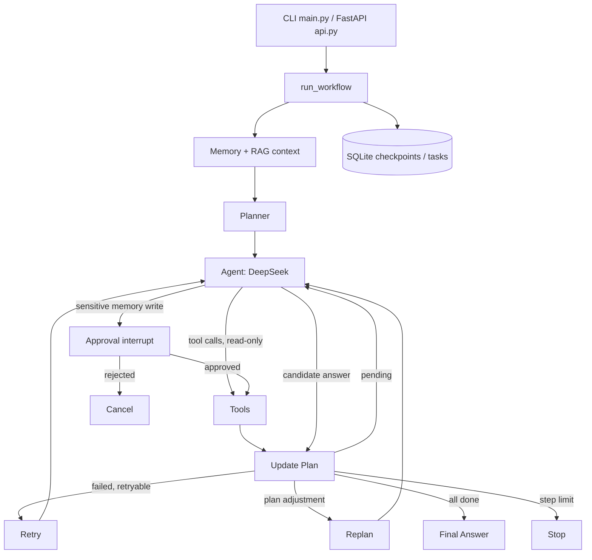
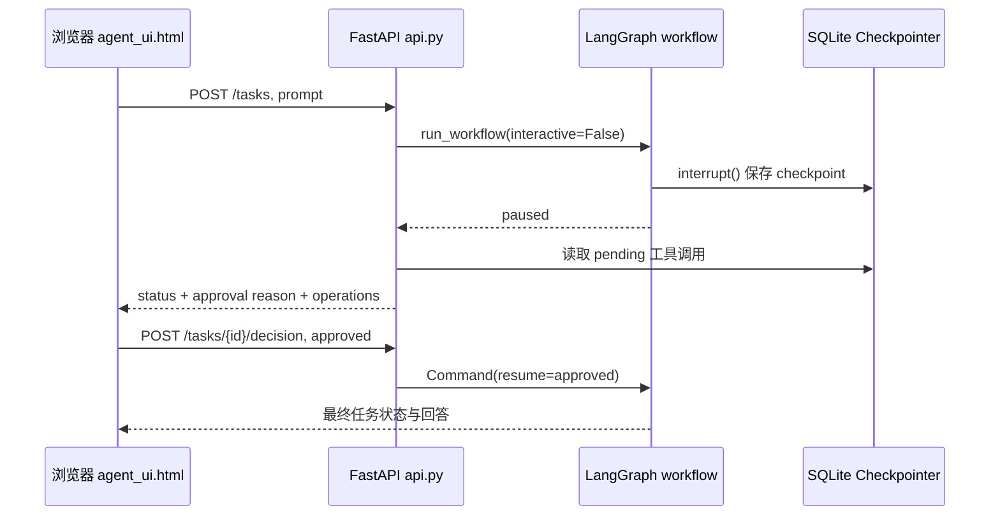

# Agent Project — 21-Day AI Agent Engineering Project

基于 **DeepSeek + LangGraph + SQLite + RAG + FastAPI** 的本地任务执行 Agent。
这是一个学习和面试演示项目，**不是**可公开部署的多用户生产服务。

## 能做什么

- 使用 DeepSeek 的 OpenAI-compatible Tool Calling，调用本地加法、乘法、知识检索和记忆工具。
- 使用 Sentence Transformers 检索 `knowledge.txt`，将相关长期记忆和知识加入任务上下文。
- 由 Planner 制定任务计划，Agent 执行，Update Plan / Replan 更新与修正计划。
- LangGraph StateGraph 控制节点与条件路由；`AgentState` 区分消息、计划、工具历史与执行进度。
- 对更改长期记忆的工具调用使用 `interrupt()` 人工审批。
- 使用 SQLite Checkpointer 保存各个 thread 的执行现场；`tasks.sqlite` 单独记录任务状态。
- 记录日志和模型请求超时/重试配置，并支持有限的失败恢复。
- 提供命令行 `main.py` 与本地 HTTP `api.py` 两种入口，以及 `agent_ui.html` 本地浏览器控制台。

## 系统架构



**重要区别：** `tasks.sqlite` 记录任务 ID / 标题 / 状态；
`checkpoints.sqlite` 记录同一个 thread 各节点的 State/执行现场。
`get_state(config)` 读取对应 thread 的最新 checkpoint；
`invoke(Command(resume=...))` 恢复中断任务。
中断节点在恢复时可能从头执行；副作用工具应放在批准之后，并考虑幂等性。

## 在 Windows PowerShell 运行

```powershell
cd C:\Users\Admin\Desktop\agent_project
git pull --ff-only origin main
.\.venv\Scripts\python.exe -m pip install -r requirements.txt
```

在本地 `.env` 写入 `DEEPSEEK_API_KEY=你的密钥`，**不要提交真实密钥**。
首次使用 embedding 可能需要下载 Hugging Face 模型。

### 命令行

```powershell
.\.venv\Scripts\python.exe main.py
```

支持：普通自然语言任务、`tasks`、`approve 1`、`reject 1`、`failed`、
`resume <thread_id>`、`clear`、`exit`。

### FastAPI（只在本机使用）

```powershell
.\.venv\Scripts\python.exe -m uvicorn api:app --host 127.0.0.1 --port 8000
```

浏览器打开 [http://127.0.0.1:8000/ui](http://127.0.0.1:8000/ui) 使用任务操作页面（包含暂停原因、批准与拒绝按钮）。
[http://127.0.0.1:8000/docs](http://127.0.0.1:8000/docs) 是 API 开发者调试文档。

接口：

| 接口 | 作用 |
|---|---|
| `GET /health` | 服务健康检查 |
| `POST /tasks` | 提交 `{"prompt": "计算 10+20"}`，返回 task ID、状态与答案 |
| `GET /tasks` | 查询暂停/失败任务 |
| `GET /tasks/{task_id}` | 查询单个任务状态 |
| `POST /tasks/{task_id}/decision` | 传 `{"approved": true}` 或 `false` 决定是否批准 |
| `POST /tasks/{task_id}/retry` | 传 `{"confirm_safe_to_retry": true}` 确认安全后重试失败任务 |

注意：当前 HTTP 入口每次使用新的对话上下文，但任务本身的 State 从 checkpoint 恢复；
还**不支持**跨 HTTP 请求的独立多轮聊天会话。HTTP 调用同步执行，长任务可能让请求持续很久。
API **没有身份认证、授权、速率限制或多租户隔离**，请勿绑定 `0.0.0.0` 或暴露到公网。
不要让其他人访问本地记忆或审批接口。

### 浏览器控制台与人工审批流程

打开 `http://127.0.0.1:8000/ui` 后，可以提交自然语言任务、查看暂停任务和执行“批准/拒绝”。



浏览器显示的审批理由和工具参数来自**已保存的 checkpoint**，不是前端猜测。
即使刷新页面，也能从暂停任务列表重新选中任务进行审批。
**审批前应阅读工具参数，确认要修改的长期记忆正确。**

#### 前端实现范围（面试需要掌握到什么程度）

- `agent_ui.html` 是轻量原生网页：HTML 定义输入框/按钮，CSS 负责样式，JavaScript 用 `fetch()` 请求 FastAPI。
- `POST /tasks` 提交任务，接口返回 `id / status / answer / approval`。`status=paused` 且需要审批时，页面展示操作参数和批准/拒绝按钮。
- 点击按钮调用 `POST /tasks/{task_id}/decision`，后端经 `Command(resume=True/False)` 恢复 LangGraph。
- 前端不会直接执行工具或调用 DeepSeek；模型调用、持久化和权限检查在 Python 后端。

本项目的重点是 **Agent 编排与后端工程**，前端只是一个操作演示，不依赖 React/Vue，
不需要对其进行前端框架层面的深度学习。

## 测试

```powershell
.\.venv\Scripts\python.exe -m unittest discover -s tests -v
```

Day 20 新增 `tests/test_api.py`，利用 mock 测试 API 的参数校验、审批及创建任务接口，
不调用 DeepSeek；既有测试继续检验图工作流行为。

人工验收建议：在 `/ui` 运行普通计算、请求保存长期记忆、核对审批参数，
点击批准或拒绝；重启服务后刷新暂停任务列表并继续处理。
再用临时模拟故障检查 `failed` → `retry`，**不要**用非幂等工具随意测试重复执行。
这些端到端在线场景仍需在具有本地 API Key 的机器上实际验证，不能视作已通过。

## 项目模块

| 文件 | 职责 |
|---|---|
| `main.py` | CLI、任务命令、模型客户端 |
| `api.py` | FastAPI HTTP 接口与审批详情读取 |
| `agent_ui.html` | 原生 HTML/CSS/JavaScript 本地网页控制台 |
| `main_config.py` | HTTP 入口使用的系统提示词 |
| `workflow.py` | LangGraph 节点、路由、审批及持久化恢复 |
| `state.py` | AgentState 及 Reducer |
| `agent.py` | 模型请求和工具分发 |
| `planner.py` | 计划创建、状态更新和重规划 |
| `tools.py` | 可调用工具定义 |
| `memory.py` / `context.py` | 长期记忆、上下文构造 |
| `task_manager.py` | SQLite 任务目录 |

## 已知限制和后续工程方向

1. DeepSeek 输出不保证每次采用相同工具路径；本项目是单 Agent 的计划式编排，不能称作真正的多智能体协作平台。
2. SDK 的 `max_retries` 仅针对可重试网络/API 异常；工具级 `retry_node` 是另一层机制。
3. 工具执行的业务异常会在 `execute_tools` 中捕获并反馈模型；无法恢复的节点异常由外层标记失败。
4. 当前副作用工具缺少统一去重键/事务防重放；失败恢复必须人工确认。
5. HTTP 不提供认证、会话隔离、异步任务队列、并发控制及生产级可观测性。
6. 需要运行真实在线演示测试，才能宣称完整端到端验证成功。

## 面试介绍（简版）

> 我从零搭建了一个基于 DeepSeek 的 Python Agent，先实现 Tool Calling 和知识库检索，
> 再加入 Planner、Replan 和状态管理，用 LangGraph 把原有循环重构为可追踪的图工作流。
> 为了让任务能够安全暂停与恢复，我增加了人工审批和基于 SQLite Checkpointer
> 的线程级持久化，并将任务目录与执行状态分离。最后增加了日志、有限重试、
> FastAPI 本地接口与离线测试。项目重点在执行编排、状态管理与故障恢复，
> 目前定位为工程原型，不是高并发生产系统。
