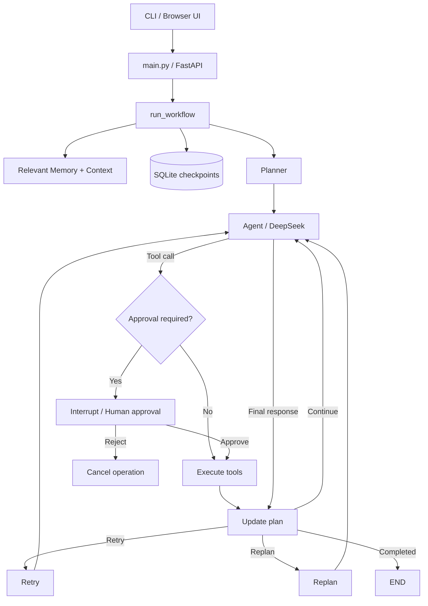

# LangGraph Multi-Tool Agent

基于 **DeepSeek API、LangGraph、RAG 与 SQLite** 实现的多工具任务执行 Agent，支持任务规划、工具调用、状态更新、重新规划，以及对长期记忆修改的人工审批和持久化恢复。

提供命令行交互与轻量级 FastAPI 本地操作界面。

## 核心功能

- **任务规划与执行**：Planner 将自然语言任务拆解为步骤，Agent 按计划调用工具；执行过程中更新步骤状态，并在必要时重试或重新规划。
- **多工具调用**：通过 OpenAI-compatible Tool Calling 调用计算、知识检索和长期记忆管理工具，处理结构化参数与工具异常。
- **知识库检索（RAG）**：使用 Sentence Transformers 生成文本向量，通过分块及余弦相似度搜索知识库，向模型提供检索上下文。
- **长期记忆**：将用户长期偏好等信息保存至本地 JSON，并根据当前任务选择相关记忆。
- **人工审批与断点恢复**：在修改长期记忆前触发 LangGraph `interrupt()`；使用 SQLite Checkpointer 保存线程状态，通过 `Command(resume=...)` 恢复任务。
- **任务状态管理**：使用独立的 SQLite 任务目录记录任务 ID、标题及状态；日志记录执行过程和异常。
- **本地交互接口**：支持 CLI、FastAPI HTTP 接口及原生 HTML/JavaScript 控制台。

## 技术栈

Python · DeepSeek API · LangGraph · SQLite · Sentence Transformers · FastAPI · HTML/JavaScript

## 系统架构



**持久化设计**：`tasks.sqlite` 管理任务目录；`checkpoints.sqlite` 保存 LangGraph 每个线程的执行状态。暂停任务可根据 `thread_id` 读取最新 Checkpoint 并恢复。

## 快速开始

要求：Python 3.10+，可用的 DeepSeek API Key。首次运行 RAG 可能需要从 Hugging Face 下载 Embedding 模型。

```bash
git clone https://github.com/LarsG33/agent_project.git
cd agent_project
python -m venv .venv
```

激活虚拟环境：Windows PowerShell 使用 `.\.venv\Scripts\Activate.ps1`；macOS/Linux 使用 `source .venv/bin/activate`。

```bash
pip install -r requirements.txt
```

在项目根目录创建 `.env`：

```dotenv
DEEPSEEK_API_KEY=your_api_key_here
```

请勿将密钥、个人记忆或本地数据库提交至版本库。

### 命令行

```bash
python main.py
```

除了自然语言输入，CLI 支持 `tasks`、`approve <序号>`、`reject <序号>`、`failed`、`resume <thread_id>`、`clear` 和 `exit`。

### 本地 Web 界面与 API

```bash
python -m uvicorn api:app --host 127.0.0.1 --port 8000
```

- 本地控制台：[http://127.0.0.1:8000/ui](http://127.0.0.1:8000/ui)
- 交互式 API 文档：[http://127.0.0.1:8000/docs](http://127.0.0.1:8000/docs)
- 健康检查：[http://127.0.0.1:8000/health](http://127.0.0.1:8000/health)

| HTTP 接口 | 功能 |
|---|---|
| `POST /tasks` | 创建并执行任务 |
| `GET /tasks` | 查询暂停和失败任务 |
| `GET /tasks/{task_id}` | 查询任务状态和审批详情 |
| `POST /tasks/{task_id}/decision` | 批准或拒绝待执行操作 |
| `POST /tasks/{task_id}/retry` | 确认安全后重试失败任务 |

### 人工审批流程

当 Agent 请求保存或删除长期记忆时，工作流在工具执行前暂停。控制台可显示待执行的工具及参数，用户批准或拒绝后，后端根据任务 ID 恢复对应的 Checkpoint。

```text
User task
   ↓
Planner → Agent → save_user_memory request
   ↓
LangGraph interrupt → SQLite checkpoint
   ↓
Browser: review operation → Approve / Reject
   ↓
Command(resume=...) → Continue / Cancel
```

## 核心模块

| 文件 | 职责 |
|---|---|
| `workflow.py` | StateGraph、节点路由、审批、任务恢复 |
| `state.py` | AgentState 状态定义与 Reducer |
| `planner.py` | 计划创建、状态更新与 Replan |
| `agent.py` / `tools.py` | 模型调用、工具定义与执行 |
| `rag.py` / `memory.py` / `context.py` | 知识检索、长期记忆及上下文构建 |
| `task_manager.py` | SQLite 任务元数据 |
| `api.py` / `agent_ui.html` | FastAPI 接口与浏览器控制台 |
| `main.py` | 命令行入口 |

## 测试

```bash
python -m unittest discover -s tests -v
```

仓库包含工作流调度及 HTTP 接口的离线测试。测试覆盖不等于完整的在线端到端验证；真实模型行为及人工审批流程仍需在配置 API Key 后验证。

